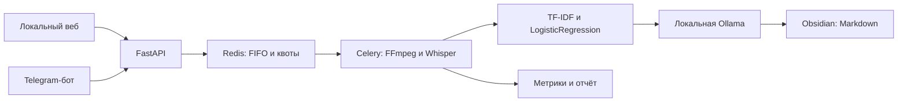

# VoiceFlow AI · MVP

Локальная обработка русскоязычного аудио: **транскрипт → стиль речи → саммари → Obsidian**.
Ввод через веб-интерфейс или Telegram-бота. Распознавание работает на CPU и NVIDIA GPU.
Зависимости управляются через **uv**, установка — по `uv.lock`.

Учебная задача: **0 — разговорный, 1 — официальный**. Подлинность голоса не определяется;
TTS предусмотрен для аугментации обучающей выборки, а не для метки «фейк».

## Возможности

- Локальный Faster-Whisper: CPU/int8 или CUDA/float16.
- TF-IDF + LogisticRegression: стиль речи и оценка классификатора.
- Локальная Ollama: саммари с выбором роли по стилю записи.
- Obsidian: отдельные Markdown-файлы транскрипта и саммари.
- Веб: загрузка, очередь, отмена, стиль, метрики и отчёт запусков.
- Telegram: голосовые, аудио, видео, выбор роли, очередь и отмена; при включении —
  стиль, метрики и фрагменты текста в ответе.
- Общий FIFO для веба и бота: квоты, защита от повторов и таймауты.
- Docker Desktop / Windows: конфигурации CPU, GPU и папки Obsidian.

Диаризация NeMo и альтернативный WhisperX выключены по умолчанию и требуют
дополнительных зависимостей. Без диаризации число реальных участников не измеряется.

## Архитектура



В режиме `style_classifier` класс 0 выбирает `prompt_2`, класс 1 — `prompt_1`.
Роли `prompt_1..5` выполняют саммаризацию без классификации. API возвращает
`classification`, `metrics`, фрагменты текста и `saved_notes`.
`confidence` — оценка модели, а не измеренная точность или калиброванная вероятность.

## Результаты базового классификатора

Фактический локальный эксперимент **без TTS**, зафиксирован 17 ноября 2026 года:

| Выборка / модель | Accuracy | Balanced accuracy | Macro-F1 |
|---|---:|---:|---:|
| Validation / TF-IDF + LR | 94,30% | 87,80% | 0,9005 |
| Test / TF-IDF + LR | 94,86% | 88,70% | 0,9094 |
| Test / постоянный baseline | 81,57% | 50,00% | 0,4493 |

Test recall разговорного класса — **78,93%**, официального — **98,46%**.
Разметка слабая, по доменам корпуса; эти числа не измеряют качество на произвольных
голосовых Telegram. Групповое разбиение даёт неравные доли строк, train несбалансирован.
TTS-сравнение пока не опубликовано.

Обезличенные метрики, confusion matrix и отпечатки выборок:
[docs/results/baseline.json](docs/results/baseline.json).
Методика и ограничения: [DZ_03/Отчёт.md](DZ_03/Отчёт.md).
Датасет и обученные веса в Git не включаются.

## Быстрый старт: Windows и Docker Desktop

Нужны uv, Python 3.12, Docker Desktop с Linux-контейнерами / WSL2.
Для GPU нужен NVIDIA-драйвер с поддержкой WSL; обучение классификатора работает на CPU.
Команды выполняются в PowerShell **из корня клонированного репозитория**.

### 1. Подготовить классификатор

```powershell
uv sync --locked --extra training
uv run --locked --extra training python -m scripts.download_balalaika
uv run --locked --extra training python -m DZ_03.model_pre
uv run --locked --extra training python -m DZ_03.train_classifier
```

Загрузчик скачивает публичные текстовые аннотации, не аудиоархивы. Результат —
`models/style_classifier.joblib`; без него режим классификатора возвращает 503.
При наличии собственной совместимой модели обучение можно пропустить.
Подробная методика и локальный TTS: [DZ_03/RUNBOOK.md](DZ_03/RUNBOOK.md).

### 2. Настроить окружение

```powershell
.\scripts\docker.ps1 -Action init
```

Помощник создаёт `.env.docker`, два разных случайных API-ключа и папку `models`,
сохраняя существующие настройки. Если политика Windows запрещает `.ps1`, при первом
запуске скопируйте `.env.docker.example` в `.env.docker` вручную и задайте два ключа.
Случайный ключ: `uv run --locked python -c "import secrets; print(secrets.token_urlsafe(32))"`.

| Поле `.env.docker` | Назначение |
|---|---|
| `VOICEFLOW_API_TOKEN` | Ключ доступа из веб-интерфейса |
| `VOICEFLOW_BOT_API_TOKEN` | Отдельный ключ между ботом и API |
| `OLLAMA_MODEL` | Имя загруженной модели Ollama |
| `HF_TOKEN` | Необязательный токен для скачивания моделей Hugging Face |
| `TELEGRAM_BOT_TOKEN` | Токен Telegram-бота, если он нужен |
| `BOT_ALLOWED_USER_IDS` | Числовые Telegram ID разрешённых пользователей |
| `BOT_SEND_RESULTS` | `true` — вернуть стиль, метрики и фрагменты текста в Telegram |
| `TELEGRAM_PROXY_URL` | Необязательный HTTP/SOCKS-прокси для Telegram |

В Git находятся только шаблоны окружения с пустыми ключами.

### 3. Собрать и запустить

CPU, веб и папка Obsidian на Windows:

```powershell
docker compose --env-file .env.docker -f docker-compose.yml -f docker-compose.storage.yml up -d --build
```

NVIDIA GPU + Telegram + папка Obsidian, после заполнения настроек бота:

```powershell
docker compose --env-file .env.docker -f docker-compose.yml -f docker-compose.gpu.yml -f docker-compose.storage.yml --profile bot up -d --build
```

GPU override добавляет библиотеки CUDA и включает Whisper `cuda / float16` без
PyTorch. Используйте тот же набор `-f` при обновлениях. Без storage override
заметки сохраняются во внутреннем Docker volume.

### 4. Загрузить модель Ollama и открыть приложение

Для значения `OLLAMA_MODEL` из исходного шаблона:

```powershell
docker compose --env-file .env.docker exec ollama ollama pull qwen3.8:27b
```

Если изменили `OLLAMA_MODEL`, используйте выбранное имя. Модели Windows Ollama
и контейнерной Ollama хранятся отдельно. Первое скачивание Whisper требует интернета;
повторный запуск использует доступный кэш модели в контейнере.

Откройте `http://127.0.0.1:8000`, введите `VOICEFLOW_API_TOKEN`, выберите классификатор
и загрузите аудио. В Telegram выберите классификатор через `/prompt`.
При `BOT_SEND_RESULTS=false` бот сообщает только о локальном сохранении.

В Obsidian откройте папку `obsidian_vault` в корне проекта как хранилище.
Перенос старых заметок, диагностика CUDA и команды обновления:
[WINDOWS_RESULTS.md](WINDOWS_RESULTS.md).

## Конфиденциальность

Распознавание, классификация и саммари выполняются локально. Веб использует локальные
CSS и системные шрифты. Для строго локального ввода используйте веб: Telegram хранит
исходные сообщения у себя; `BOT_SEND_RESULTS=true` также разрешает отправку результатов.

API опубликован только на `127.0.0.1:8000`, Redis и Ollama доступны внутри Compose.
Контейнерная Ollama не занимает порт Windows 11434. Исходники и кэш завершённых задач
очищаются по сроку хранения; заметки Obsidian сохраняются. Подробнее: [SECURITY.md](SECURITY.md).

## Разработка и проверки

```powershell
uv sync --locked
uv lock --check
uv run --locked pytest -q
```

Тесты работают без запущенных Redis, Ollama, Telegram и без GPU. Реальное декодирование
WAV проверяется при установленном дополнении `audio`; CI также собирает CPU-аудиообраз.
Технические тесты не заменяют оценку качества ASR/TTS и классификации.

Для запуска без Docker нужны FFmpeg в PATH, Redis и Ollama; настройки — из `.env`:

```powershell
uv run --locked uvicorn app.main:app --host 127.0.0.1 --port 8000
# В другом терминале:
uv run --locked --extra audio celery -A app.worker.app worker --loglevel=info --pool=solo --concurrency=1 --prefetch-multiplier=1
# Необязательный бот, ещё в одном терминале:
uv run --locked python -m bot.main
```

## Документация

| Документ | Содержание |
|---|---|
| [WINDOWS_RESULTS.md](WINDOWS_RESULTS.md) | Obsidian, CUDA, Telegram и обновление контейнеров |
| [DZ_03/RUNBOOK.md](DZ_03/RUNBOOK.md) | Данные → обучение → локальный TTS → сравнение |
| [DZ_03/01_describ.md](DZ_03/01_describ.md) | Постановка задачи и метод |
| [DZ_03/Отчёт.md](DZ_03/Отчёт.md) | Фактические результаты и ограничения |
| [docs/OPERATIONS.md](docs/OPERATIONS.md) | Очередь, квоты, отмена, таймауты и диагностика |
| [AUDIT.md](AUDIT.md) | Технические проверки MVP |
| [CONTRIBUTING.md](CONTRIBUTING.md) | Разработка и подготовка изменений к GitHub |
| [CHANGELOG.md](CHANGELOG.md) | Состав текущего MVP |
